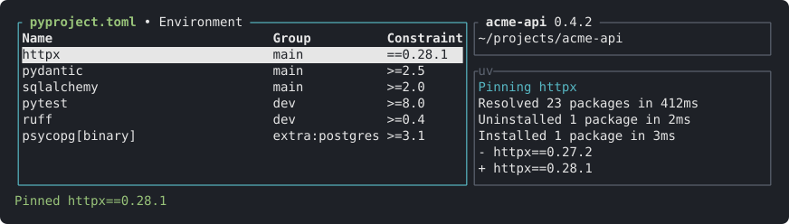

# uview

A terminal UI for [uv](https://github.com/astral-sh/uv), the Python package manager.

uview shows two views of a project:

- the dependencies declared in `pyproject.toml`;
- the packages actually installed in its environment.

From either view you can pin, update or remove a package without remembering uv's
command-line syntax. uview has no packaging logic of its own: every action runs the `uv`
binary.



**Status: early development**, not yet a daily driver. See [Status](#status).

## Requirements

- [uv](https://docs.astral.sh/uv/getting-started/installation/) on `PATH`. uview is
  tested with uv 0.8.
- Rust, installed through [rustup](https://rustup.rs). The toolchain is pinned in
  `rust-toolchain.toml`, and rustup installs it on the first build.

## Install

```bash
git clone https://github.com/levakuz/uview.git
cd uview
cargo install --path . --locked
```

This puts the `uview` binary in `~/.cargo/bin`.

## Usage

Run `uview` anywhere inside a uv project:

```bash
cd path/to/your-project
uview
```

**How it finds the project.** uview walks up from the working directory to the nearest
`pyproject.toml`, as uv does, and runs every uv command from that directory. When
`UV_PROJECT` is set, it starts from there instead.

It prints why and exits instead of starting when:

- there is no `pyproject.toml` in the directory or any parent;
- the `pyproject.toml` has neither a `[project]` table nor `[tool.uv.workspace]`;
- the `pyproject.toml` sets `[tool.uv] managed = false`.

**The two tables.**

- **pyproject.toml** lists the declared dependencies. For each one it shows the group it
  belongs to (`main`, a dependency group, or `extra:<name>`) and its version constraint.
- **Environment** lists what is installed in the project's environment. That is `.venv` at
  the project root, or the path in `UV_PROJECT_ENVIRONMENT`, not whichever virtualenv is
  activated. If the environment does not exist yet, run `uv sync` once.

**The bottom line** shows the latest error or notice on the left and the project root on
the right.

### Actions

Press `Space` on a package to open its actions:

| Action | What it does |
|---|---|
| Pin to version | Asks for a constraint, then writes it to `pyproject.toml` with `uv add` in every group the package is declared in, and syncs. `1.2.3` becomes `==1.2.3`; `>=2.0` and `<3` are kept as typed. A package that is installed but not declared is added as a main dependency. |
| Update | Runs `uv sync --upgrade-package`: the newest version the constraints allow. |
| Remove | **pyproject.toml table:** runs `uv remove` for every group and extra the package is in, then syncs.<br>**Environment table:** runs `uv pip uninstall` on the environment only. `pyproject.toml` and `uv.lock` are untouched, so the next `uv sync` brings a declared package back. |
| Cancel | Closes the list. |

Syncs run `uv sync --inexact`, which keeps installed packages that are not in the lockfile.

### Keybindings

| Key | Action |
|---|---|
| `↑` / `k`, `↓` / `j` | Move the selection. Table selections wrap around at the ends. |
| `Tab`, `[`, `]` | Switch between the pyproject.toml and Environment tables. |
| `Space` | Open the actions for the selected package. In the actions list, run the highlighted one. |
| `Enter` | Confirm the version typed for **Pin to version**. |
| `Esc` | Close a popup or cancel input, and dismiss the message on the bottom line. |
| `p` | Open the add-package input. It is not wired to `uv add` yet ([#8](https://github.com/levakuz/uview/issues/8)). |
| `q` | Quit. |

While you type a version, every key except `Enter` and `Esc` goes into the field.

## Status

uview is pre-release. Everything described above works. Notable gaps:

- Adding packages ([#8](https://github.com/levakuz/uview/issues/8)).
- Running `uv sync` as an action ([#10](https://github.com/levakuz/uview/issues/10)).
- In a member of a uv workspace, the Environment table and **Remove** act on the member's
  `.venv`. The workspace's own environment is not used
  ([#58](https://github.com/levakuz/uview/issues/58)).

The roadmap lives in the [milestones](https://github.com/levakuz/uview/milestones), one per
sprint. The work items are the [issues](https://github.com/levakuz/uview/issues).

## Development

- [AGENTS.md](AGENTS.md) is the working agreement: commands, code conventions, testing
  and the git workflow.
- [docs/ARCHITECTURE.md](docs/ARCHITECTURE.md) describes how the code is built today and
  the design we are working toward. Read it before changing anything structural.
- [docs/adr/](docs/adr/) records the architecture decisions.
